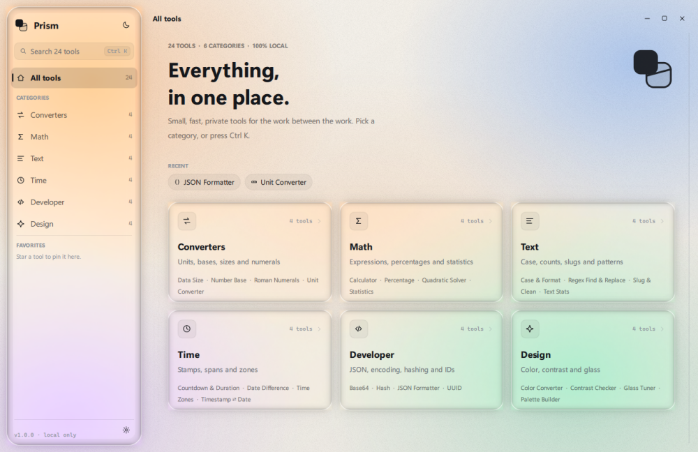
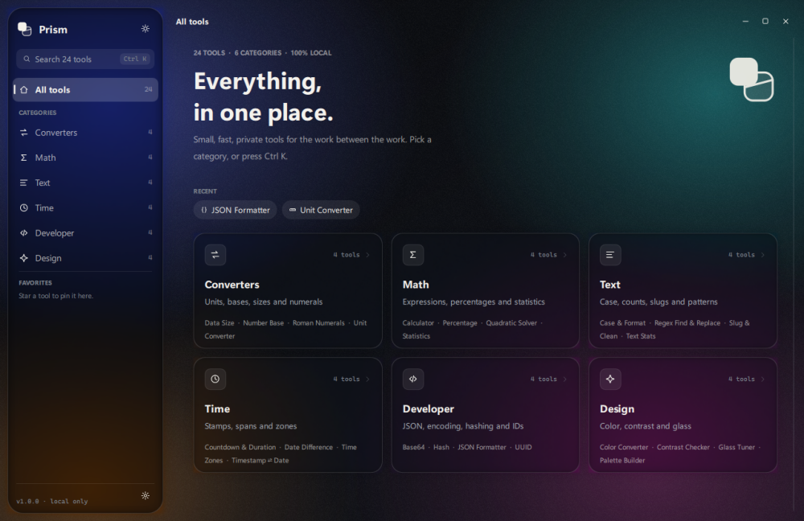
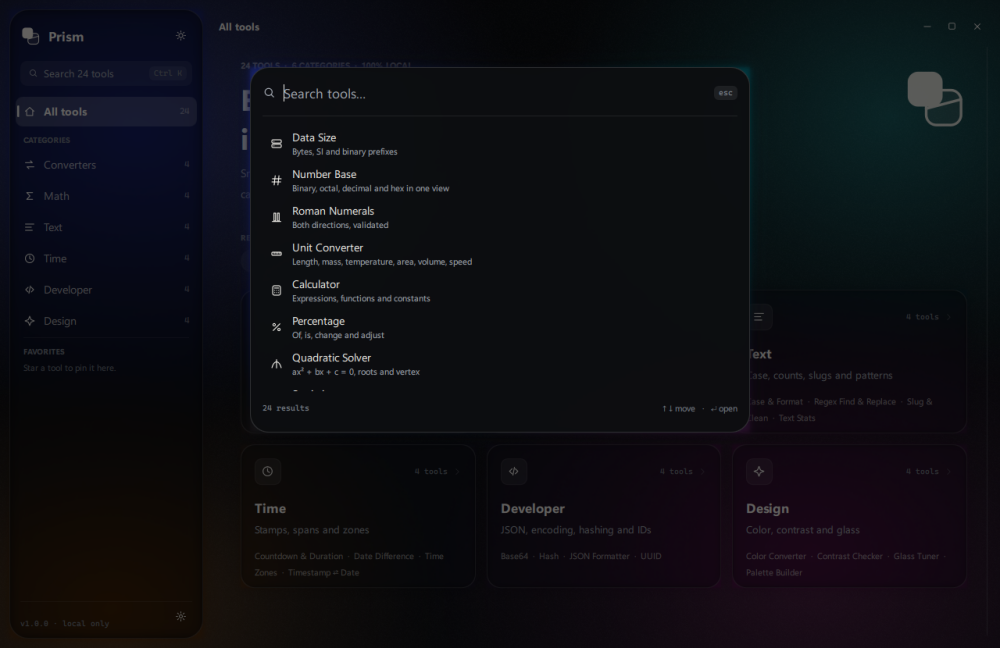
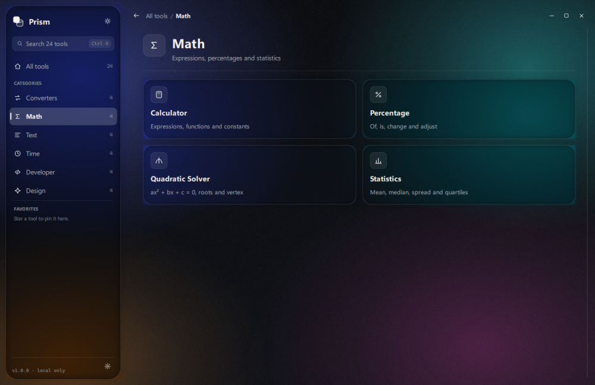
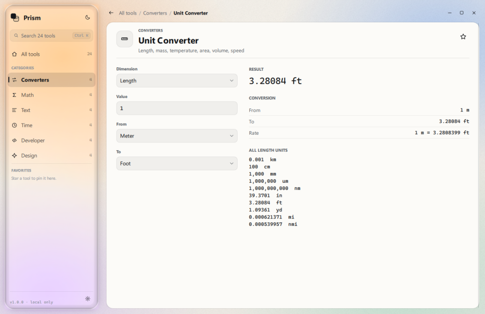
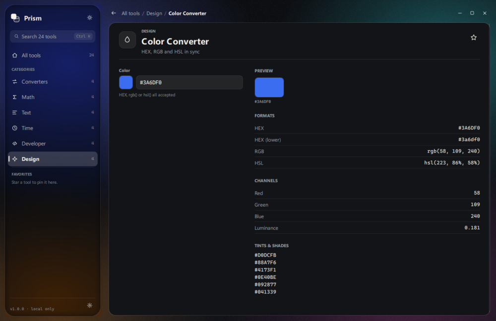
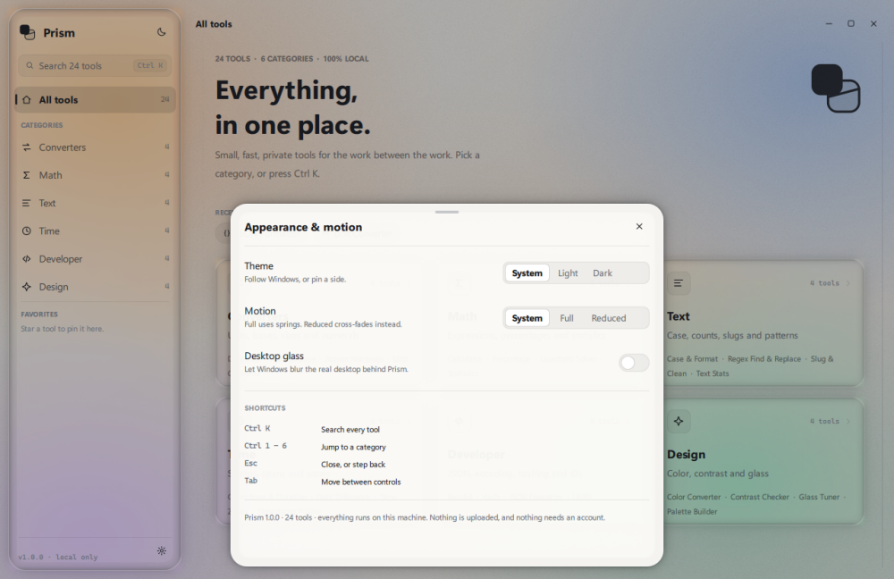

# Prism

[](LICENSE)
[](https://www.python.org)
[](#run-from-source)

A one-window desktop toolbox: 24 small utilities in six categories, with a real
frosted-glass shell and quiet, monochrome working surfaces. Everything runs
locally — no account, no network calls, no telemetry.

Python + PySide6 (Qt Quick) and shipped as a portable Windows folder with a
single `Prism.exe`.



## What's inside

| Category | Tools |
| --- | --- |
| **Converters** | Data Size · Number Base · Roman Numerals · Unit Converter |
| **Math** | Calculator · Percentage · Quadratic Solver · Statistics |
| **Text** | Case & Format · Regex Find & Replace · Slug & Clean · Text Stats |
| **Time** | Countdown & Duration · Date Difference · Time Zones · Timestamp ⇄ Date |
| **Developer** | Base64 · Hash · JSON Formatter · UUID |
| **Design** | Color Converter · Contrast Checker · Glass Tuner · Palette Builder |

Every tool is live: type and the results recompute as you go (debounced at
110 ms), each result block can be copied with one click, tools can be starred
into favorites, and recents are remembered between sessions.

| Dark | Palette |
| --- | --- |
|  |  |

| Category | A tool |
| --- | --- |
|  |  |





## Design

The interface follows the Apple-design ideas the app was built around:

- **Real glass, not a flat tint.** Each panel samples the wallpaper behind it,
  blurs it through a rounded-rect mask, and adds a rim highlight plus a soft
  shadow ring that falls outside the surface. When desktop glass is enabled the
  panels stop faking frost and let the OS acrylic do the work instead.
- **Monochrome interiors.** Tool surfaces are paper — `#FCFBF8` in light,
  `#121417` in dark — and every result uses ink, hairline rules and mono
  numerals. Colour only ever enters through the wallpaper showing through glass.
- **Springs, not easing curves.** Hover lift, press scale, sheets and the
  palette use `SpringAnimation` with measured stiffness/damping, so interruptions
  (clicking mid-animation) stay continuous. Windows' "animation effects" setting
  and an in-app switch both collapse motion to zero.
- **Restraint.** One accent per surface, hairlines instead of boxes, tabular
  numerals for data, tracking tightened as type grows.
- **A real fallback.** Without a wallpaper, a blur-capable backend or with
  desktop glass on, panels fall back to an opaque tint that still reads as glass.

## Run from source

```bash
python -m venv .venv
.venv/Scripts/python.exe -m pip install -r requirements-dev.txt
.venv/Scripts/python.exe prism.py
```

Windows 10/11 is the target: window chrome (rounded corners, dark titlebar) and
acrylic use the Win32 DWM API, and `tzdata` supplies the IANA database that
`zoneinfo` cannot read from the OS registry.

### Keyboard

| Keys | Action |
| --- | --- |
| `Ctrl K` | Command palette — search all 24 tools |
| `Ctrl 1 … 6` | Jump to a category |
| `Ctrl F` | Focus search |
| `Tab` / `Shift Tab` | Move between controls and cards |
| `↑` `↓` `Enter` | Move and open inside the palette |
| `Esc` | Close the sheet/palette, or step back one level |

## Tests

```bash
.venv/Scripts/python.exe -m pytest -q
```

105 tests: the schema helpers and every module's maths are unit-tested, and the
app itself is driven as a subprocess (`--smoke`) so the real QML tree is
exercised — navigation, live edits, error states, the palette, favorites,
theme switching — with any Qt warning treated as a failure.

The entry point doubles as a diagnostic CLI:

```bash
python prism.py --self-test                       # every module with its defaults
python prism.py --smoke                           # drive the whole UI headlessly
python prism.py --theme dark --view module:unit --screenshot shot.png
```

## Build the portable exe

```bash
.venv/Scripts/python.exe tools/build.py
```

That regenerates the SVG assets and `assets/prism.ico`, freezes with
PyInstaller (`--windowed`, one folder), deletes the Qt modules Prism never loads
(WebEngine alone is ~195 MB, so the folder drops from ~405 MB to ~168 MB),
then verifies the result by running the *frozen* executable's `--self-test`,
`--smoke` and both light/dark screenshot renders. Output:

```
dist/Prism/Prism.exe                  # portable, no installer
dist/Prism-1.0.0-win64.zip            # ~64 MB, unzip anywhere and run
```

The build fails loudly if a pruned bundle stops rendering or stops passing its
own smoke test.

## Layout

```
prism.py                 entry point (also --self-test / --smoke / --screenshot)
app/                     Qt bootstrap, bridge, settings, Win32 chrome, icon provider
engine/                  tool schema, registry/search, 24 modules (pure Python)
ui/qml/                  shell, sidebar, home, category, module view, sheets
ui/qml/theme/            Theme (tokens), Motion (springs), Icons (asset paths)
assets/                  hand-written SVG logo, mark, icons, wallpapers, app icon
tools/                   asset/icon generators and the build script
tests/                   pytest suites (engine + shell)
```

Adding a tool means writing one `Module` subclass in `engine/modules/` — fields,
defaults and an `outputs()` result — and importing it in that package's
`__init__`. The launcher, search, favorites and the QML form are generated from
that declaration; no UI code changes.

## License

MIT — see [LICENSE](LICENSE). Use it, fork it, ship it; just keep the copyright
notice. Contributions are welcome under the same terms.
